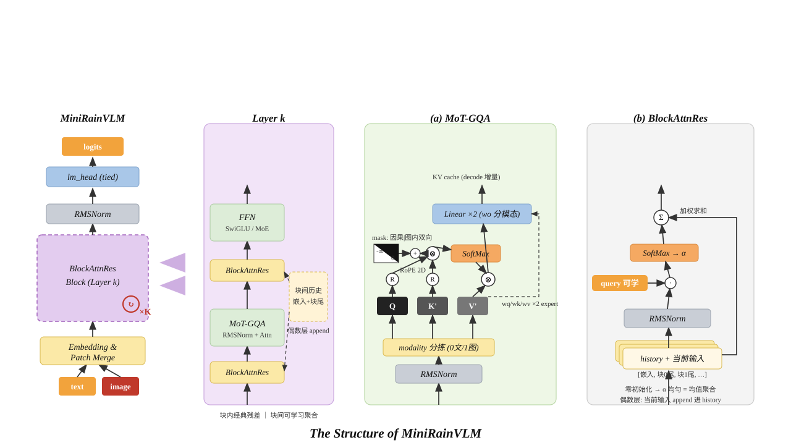

# MiniRain-Vision

MiniRain-Vision 是一个从零实现的轻量级视觉语言模型（VLM）。其核心 **MiniRainVLM** 采用**单流统一架构**：不使用独立的视觉编码器 + 跨注意力，而是将图像 patch 作为普通 token 直接注入语言模型的同一序列，由一个 Transformer 主干统一处理文本与图像。

## 模型架构

<div align="center">
  
</div>

### 核心组件说明

| 组件 | 作用 | 关键设计 |
|------|------|----------|
| **输入融合** | 文本/图像统一序列 | patch 嵌入 in-place 覆盖 `image_pad` 占位，无独立视觉塔 |
| **2D RoPE** | 位置编码 | 图像 (行,列) 双轴，文本 (t,t) 退化 1D，支持 YaRN 插值 |
| **MoT-GQA** | 注意力 | QKVO 按模态分 expert，注意力全局共享，纯文本零开销 |
| **BlockAttnRes** | 跨块信息聚合 | 可学习加权历史块尾 + 当前输入，替代恒等残差 |
| **Mask** | 注意力约束 | 文本因果 | 图像段内双向 | 跨段隔离 |
| **MLP** | 非线性变换 | SwiGLU（dense）或 LosslessMoE（无辅助损失 MoE） |

### 单流多模态序列

图像经 `Conv2d(patch_size)` 切成 patch 后展平（行优先），覆盖序列中 `<|image_pad|>` 占位位置的文本嵌入，与文本 token 一起走同一条主干：

```
BOS  <|vision_start|> [patch × R*C + 行换行符] <|vision_end|>  文本...  EOS
```

loss 只落在文本 + EOS 上，图像段全部为上下文。

### 2D RoPE（支持 YaRN）

- 图像 patch(i,j) 的位置编码为 `(base+i, base+j)`，行/列各占 head_dim 的一半
- 文本位置退化为 `(t, t)`，即标准 1D RoPE
- 换行符位于 `(base+i, base+C)`，宽图按 `max(R,C)` 推进游标，避免列坐标与后续文本碰撞
- 频率表支持 YaRN 插值（`inference_rope_scaling=True` 启用）

### MoT 注意力（Mixture-of-Transformers）

Q/K/V/O 四个投影按模态解耦为文本/图像两套 expert，注意力计算全局共享。纯文本输入时 `modality_mask=None`，全体直接走文本 expert，**零额外开销退化为普通 GQA**。

### 图像双向注意力

注意力 mask = `因果 | 同图段`：文本保持因果，同一张图内的 patch 之间双向可见，padding 只屏蔽 key 维。

### 块注意力残差（BlockAttnRes）

块内（`block_size//2` 层为一组）保留经典残差；块间用可学习聚合替代恒等捷径——每层的 attn/mlp 输入 = 对所有前序块尾（含嵌入输出）与当前输入的加权混合，权重由 `attn_res_query` 打分产生（零初始化时等价于均匀平均）。

### 其余组件

- GroupQueryAttention（GQA）+ QK-RMSNorm
- SwiGLU（dense）或 LosslessMoE（`use_moe=True`，无辅助损失的偏置均衡路由 + 共享专家）
- RMSNorm、Flash Attention（`scaled_dot_product_attention`）
- KV cache 增量解码，generate 内置视觉结构 token 采样屏蔽

## 目录结构

```
architectures/   rain.py(模型主体) / config.py(RainConfig)
components/      attention.py(MoT-GQA) / block.py(残差块) / mlp.py(SwiGLU/MoE) / norm.py
dataset/         collator.py(VLMCollator 序列拼装+位置编号) / datasets.py
tokenizers/      BPE tokenizer(含 <|vision_start|> 等视觉 token)
train/           train_pre.py / train_sft.py / train_grpo.py / train_util.py
cli/             eval.py
ready/           预训练/SFT/RLAIF 检查点
tests/           测试套件(见下)
```

## 快速开始

```python
import torch
from architectures.config import RainConfig
from architectures.rain import MiniRainVForCausalLM

cfg = RainConfig(hidden_size=1024, n_hidden_layers=12, block_size=4,
                 n_attn_heads=8, n_key_value_heads=4)
model = MiniRainVForCausalLM(cfg).cuda()

# 纯文本
ids = torch.randint(3, 6000, (1, 32)).cuda()
out = model(input_ids=ids, labels=ids)

# 图文: 用 VLMCollator 拼序列(自动处理位置编号/截断保护)
from dataset.collator import VLMCollator
collator = VLMCollator(tokenizer, patch_size=cfg.patch_size)
batch = collator([{"image": img_tensor, "text": "描述这张图"}])

# 生成
gen = model.generate(inputs=ids, max_new_tokens=64, do_sample=False)
```

